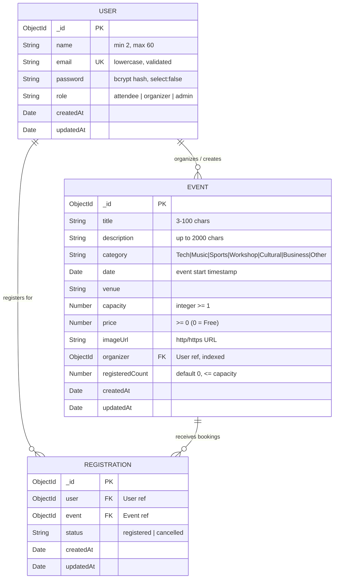

# Event Management Portal — Database Schema Documentation
**Owner:** Kushagra (Database & Mongoose Architect)  
**Database Name:** `event_portal`  
**ORM / ODM:** Mongoose 8.x for MongoDB

---

## 1. Entity Relationship Overview (ERD)



---

## 2. Collections & Field Specifications

### 2.1 `users` Collection

Stores account profiles and access tier credentials across attendees, organizers, and administrators.

| Field | Type | Required | Constraints & Defaults | Notes |
| :--- | :--- | :--- | :--- | :--- |
| `_id` | `ObjectId` | Auto | Generated by MongoDB | Primary Key |
| `name` | `String` | Yes | Trimmed, Min: 2, Max: 60 | User's full display name |
| `email` | `String` | Yes | Unique, Lowercase, Trimmed | Validated with email regex format |
| `password` | `String` | Yes | Min: 6 chars, `select: false` | Hashed with bcrypt (10 salt rounds) |
| `role` | `String` | Yes | Enum: `attendee`, `organizer`, `admin`. Default: `attendee` | Controls role-based authorization |
| `createdAt` | `Date` | Auto | Managed by Mongoose | Timestamp of registration |
| `updatedAt` | `Date` | Auto | Managed by Mongoose | Timestamp of last profile update |

#### User Methods & Hooks:
- **`pre('save')`**: Automatically hashes password before persistence if modified.
- **`comparePassword(candidate)`**: Validates plain-text password against stored bcrypt hash.
- **`pre(['deleteOne', 'findOneAndDelete'])`**: Cascade removes user registrations upon account deletion.

---

### 2.2 `events` Collection

Stores all event listings published by organizers.

| Field | Type | Required | Constraints & Defaults | Notes |
| :--- | :--- | :--- | :--- | :--- |
| `_id` | `ObjectId` | Auto | Generated by MongoDB | Primary Key |
| `title` | `String` | Yes | Trimmed, Min: 3, Max: 100 | Event headline |
| `description` | `String` | Yes | Trimmed, Max: 2000 chars | Detailed event briefing |
| `category` | `String` | Yes | Enum: `Tech`, `Music`, `Sports`, `Workshop`, `Cultural`, `Business`, `Other` | Event domain category |
| `date` | `Date` | Yes | ISO Date / Time | Event start timestamp |
| `venue` | `String` | Yes | Trimmed | Physical or virtual location |
| `capacity` | `Number` | Yes | Integer >= 1 | Maximum attendee seats allowed |
| `price` | `Number` | No | Default: `0`, Min: 0 | Event admission fee (0 = Free) |
| `imageUrl` | `String` | No | Default: `""`, Validated HTTP/HTTPS URL | Cover picture URL |
| `organizer` | `ObjectId` | Yes | Ref: `User`, Indexed | Event owner and host |
| `registeredCount` | `Number` | No | Default: `0`, Min: 0, Max: `capacity` | Active attendee counter |
| `createdAt` | `Date` | Auto | Managed by Mongoose | Listing creation timestamp |
| `updatedAt` | `Date` | Auto | Managed by Mongoose | Last modification timestamp |

#### Virtual Fields (Computed on Read):
- **`isFull`**: Returns `true` if `registeredCount >= capacity`, else `false`.
- **`seatsLeft`**: Returns `Math.max(0, capacity - registeredCount)`.
- *Both virtuals are automatically exposed in `toJSON` responses.*

#### Event Hooks:
- **`pre(['deleteOne', 'findOneAndDelete'])`**: Cascade deletes all dependent registrations when an event is deleted.

---

### 2.3 `registrations` Collection

Associates attendees with events they have reserved seats for.

| Field | Type | Required | Constraints & Defaults | Notes |
| :--- | :--- | :--- | :--- | :--- |
| `_id` | `ObjectId` | Auto | Generated by MongoDB | Primary Key |
| `user` | `ObjectId` | Yes | Ref: `User` | Attendee who registered |
| `event` | `ObjectId` | Yes | Ref: `Event` | Target event booked |
| `status` | `String` | Yes | Enum: `registered`, `cancelled`. Default: `registered` | Active or cancelled booking |
| `createdAt` | `Date` | Auto | Managed by Mongoose | Timestamp booking was made |
| `updatedAt` | `Date` | Auto | Managed by Mongoose | Timestamp of cancellation or update |

---

## 3. Database Indexes & Query Optimizations

### 3.1 `User` Indexes
- `{ email: 1 }` (Unique): Ensures zero duplicate user emails and O(1) login lookup.

### 3.2 `Event` Indexes
- `{ date: 1 }`: Supports chronological timeline sorting and date range queries (`from` / `to`).
- `{ category: 1, date: 1 }` (Compound): Optimizes category filtering combined with chronological sorting.
- `{ organizer: 1 }`: Accelerates the Organizer Dashboard query (`/api/events/mine`).
- `{ title: 'text', description: 'text', venue: 'text' }` (Text Index): Powers full-text keyword searches with weighted priority (`title: 5`, `venue: 2`, `description: 1`).

### 3.3 `Registration` Indexes
- `{ user: 1, event: 1 }` (Unique Compound): **Enforces zero duplicate bookings**. A user can only register once per event.
- `{ event: 1, status: 1 }` (Compound): Speeds up counting active registrations for an event and retrieving attendee lists.
- `{ user: 1, status: 1 }` (Compound): Speeds up retrieving "My Registrations" for logged-in attendees.

---

## 4. Concurrency Protection & Atomic Seat Reservation

To eliminate race conditions and overbooking when multiple attendees register for the final seat simultaneously, registration avoids naive `read-then-write` logic.

### 4.1 Atomic Seat Increment Query:
```javascript
const updatedEvent = await Event.findOneAndUpdate(
  {
    _id: eventId,
    $expr: { $lt: ['$registeredCount', '$capacity'] } // Atomic seat check
  },
  {
    $inc: { registeredCount: 1 } // Atomic increment
  },
  {
    new: true,
    runValidators: true
  }
);

if (!updatedEvent) {
  // Document was not matched because registeredCount was already equal to capacity
  return res.status(409).json({ success: false, message: 'Event is already fully booked' });
}
```

### 4.2 Atomic Seat Decrement Query:
```javascript
await Event.findOneAndUpdate(
  { _id: eventId, registeredCount: { $gt: 0 } },
  { $inc: { registeredCount: -1 } },
  { new: true }
);
```

---

## 5. Available Scripts & Usage

- **Seed Database**:
  ```bash
  npm run seed
  ```
  *Wipes database, creates 16 users, 24 realistic events across 7 categories, and ~60 registrations with guaranteed integrity.*

- **Verify Database Integrity**:
  ```bash
  npm run verify
  ```
  *Runs 5 comprehensive consistency checks (seat counts, orphans, capacity bounds, compound uniqueness, and virtual accuracy).*

- **Export Database to JSON Dump**:
  ```bash
  npm run dump
  ```
  *Saves snapshots of collections to `docs/db-dump/`.*

- **Restore Database from Dump**:
  ```bash
  npm run restore
  ```
  *Restores clean demo dataset on any teammate machine in under 2 minutes.*
